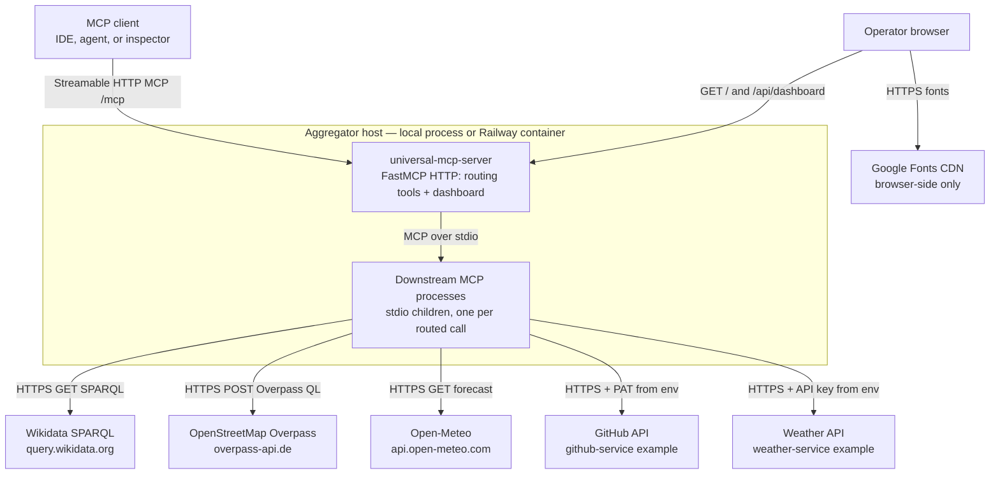
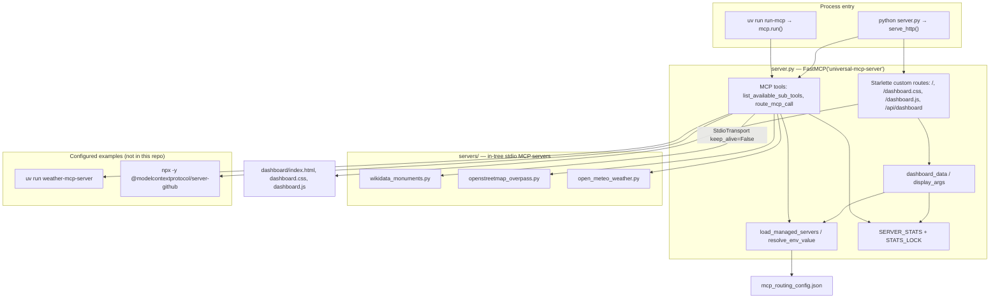

# Solution architecture

This document describes the **universal MCP aggregator** in this repository: a FastMCP host that exposes two routing tools over HTTP (and optionally stdio), launches configured downstream MCP servers as local processes, and forwards tool calls to them.

Statements below are based on the code, config, tests, and (where noted) merged pull-request text. Items that cannot be confirmed from those sources are marked **Assumption**.

Related: [CONNECTIVITY.md](CONNECTIVITY.md) (network paths, ports, protocols, trust boundaries).

## Purpose and scope

The aggregator is a single FastMCP application (`universal-mcp-server` in `pyproject.toml`; FastMCP instance name `universal-mcp-server` in `server.py`). It does **not** implement weather, maps, or GitHub logic itself. It:

1. Reads `mcp_routing_config.json` as a registry of downstream MCP servers.
2. Exposes `list_available_sub_tools` and `route_mcp_call` so an MCP client can discover those names and invoke a named tool on a named server.
3. Starts the selected downstream command over **stdio** for each routed call (`StdioTransport(..., keep_alive=False)`).
4. Serves a small **dashboard** over HTTP (`/`, static assets, `/api/dashboard`) showing config and in-memory call stats.

**In scope:** this repository’s aggregator, dashboard, routing config, in-tree public-API bridges under `servers/`, and how `python server.py` binds HTTP for Railway.

**Out of scope (not implemented here):** authentication, persistence, health checks, CI, a committed Railway/IaC config, MCP resources, MCP prompts, and the internals of the example `weather-mcp-server` / `@modelcontextprotocol/server-github` packages.

The GitHub remote is [`mkrejp/FastMCP-testserver`](https://github.com/mkrejp/FastMCP-testserver). Package version is `0.1.0`. Locked runtime libraries include FastMCP `4.1.4` and httpx `0.28.1` (`uv.lock`). Python is pinned to `3.14` (`.python-version` and `requires-python = ">=3.14"`).

## System context



**Clients**

| Client | How it connects | Evidence |
| --- | --- | --- |
| MCP client (Cursor, inspector, another FastMCP `Client`, etc.) | Streamable HTTP to the MCP endpoint when the process is started with `serve_http()` / `python server.py`. Stdio when started with `uv run run-mcp` (`run-mcp = "server:mcp.run"`). | `server.py` `serve_http()`, `pyproject.toml` scripts, README |
| Browser | Unauthenticated GET of dashboard HTML/CSS/JS and JSON | `server.py` custom routes; `dashboard/` |
| Railway edge proxy | Public HTTPS domain forwarded to the container port | [PR #3](https://github.com/mkrejp/FastMCP-testserver/pull/3); `http_port()` / `serve_http()` |

**MCP protocol and transport**

- Aggregator as a **server**: FastMCP `transport="http"` is Streamable HTTP. This repo does **not** call `transport="sse"` (FastMCP’s legacy SSE transport).
- Aggregator as a **client** of children: `fastmcp.Client` + `StdioTransport`.
- Downstream in-tree servers call `mcp.run()` with no arguments, which FastMCP treats as **stdio**.

**Assumption:** the HTTP MCP path is `/mcp`. This repository never sets a path; README and FastMCP 4 docs both document `/mcp` as the default Streamable HTTP endpoint.

**External services** are only contacted by downstream processes (or by the operator’s browser for fonts), not by `server.py` itself. See [CONNECTIVITY.md](CONNECTIVITY.md).

## Component and module overview



| Path | Role |
| --- | --- |
| `server.py` | Aggregator: config load, env interpolation, stdio routing, in-memory stats, HTTP bind, dashboard routes |
| `mcp_routing_config.json` | Registry of `managed_servers` (`command`, `args`, `env`) |
| `dashboard/` | Static Control Room UI; polls `/api/dashboard` every 5 seconds |
| `servers/wikidata_monuments.py` | Heritage lookup via Wikidata SPARQL |
| `servers/openstreetmap_overpass.py` | Nearby OSM amenities via Overpass |
| `servers/open_meteo_weather.py` | Current + 7-day hourly weather via Open-Meteo |
| `servers/__init__.py` | Empty package marker |
| `tests/test_routing.py` | Config, routing, dashboard redaction, HTTP bind/port validation |
| `tests/test_public_api_servers.py` | Bridge query construction, validation, User-Agent |
| `pyproject.toml` / `uv.lock` | Package metadata and locked deps (`fastmcp`, `httpx`) |
| `.env.example` | Contains `API_SECRET_KEY=` only; **nothing in this repo reads that variable** |
| `AGENTS.md`, `CLAUDE.md`, `.cursor/rules/project.mdc` | Contributor/agent pointers; not runtime |

There is no application database, cache, or message queue. Stats live in process memory.

## Exposed MCP tools, resources, and prompts

This repository registers **tools only**. There are no `@mcp.resource` or `@mcp.prompt` decorators.

### Aggregator (`server.py`)

| Kind | Name | Signature / notes |
| --- | --- | --- |
| Tool | `list_available_sub_tools` | Returns `list(load_managed_servers())` — configured **server names**, not the downstream tools |
| Tool | `route_mcp_call` | `(server_name, tool_name, arguments=None)` → JSON dump of the downstream MCP `CallToolResult` |
| Resource | — | none |
| Prompt | — | none |

`route_mcp_call` raises `ValueError` if `server_name` is unknown. It copies `os.environ`, overlays resolved `spec["env"]`, opens a stdio client, and calls `client.call_tool(tool_name, arguments or {})`. Downstream `isError` is treated as a failed call for stats; other exceptions are recorded as failures and re-raised.

### In-tree downstream servers

| Server name in config | Module | Tools |
| --- | --- | --- |
| `wikidata-monuments` | `servers/wikidata_monuments.py` | `search_monuments_by_country(country_code)`, `find_nearby_monuments(latitude, longitude, radius_km)` |
| `openstreetmap-overpass` | `servers/openstreetmap_overpass.py` | `get_amenities_nearby(latitude, longitude, amenity_type)` |
| `open-meteo-weather` | `servers/open_meteo_weather.py` | `get_historical_or_current_weather(latitude, longitude)` |

All three return **JSON text** (`json.dumps(...)`) as the tool result.

Bridge input limits encoded in the code:

- Country code: `^[A-Za-z]{2}$` (ISO 3166-1 alpha-2).
- Coordinates: finite, latitude `[-90, 90]`, longitude `[-180, 180]`.
- Nearby Wikidata radius: `(0, 100]` km, `LIMIT 100`.
- Overpass amenity: `^[A-Za-z0-9 _-]{1,64}$`; search radius **1000 m** (`SEARCH_RADIUS_METERS`).
- Open-Meteo: `past_days=7`, `forecast_days=1`, `timezone=auto`.

### Example downstream servers (config only)

`weather-service` (`uv run weather-mcp-server`) and `github-service` (`npx -y @modelcontextprotocol/server-github`) are registry examples. This repo does not vendor their tools. `weather-mcp-server` is **not** a declared dependency in `pyproject.toml`. `github-service` requires `npx` at runtime.

### HTTP routes (not MCP)

Registered with `@mcp.custom_route(..., include_in_schema=False)`:

| Method | Path | Handler |
| --- | --- | --- |
| GET | `/` | `dashboard/index.html` |
| GET | `/dashboard.css` | stylesheet |
| GET | `/dashboard.js` | client; `fetch("/api/dashboard")` on load and every 5s |
| GET | `/api/dashboard` | JSON from `dashboard_data()`; `500` with `{"error": ...}` on config `RuntimeError` / `ValueError` |

There is no dedicated `/health` route.

## Runtime and request flow

Two process entry points share the same FastMCP instance:

| Entry | Command | Transport |
| --- | --- | --- |
| HTTP (Railway / public) | `python server.py` → `serve_http()` | `mcp.run(transport="http", host="0.0.0.0", port=http_port())` |
| Stdio (local CLI) | `uv run run-mcp` | `mcp.run()` with no args (FastMCP default: stdio) |

`http_port()` reads `PORT`, default `"8080"`, and rejects non-integers and values outside `1..65535`.

README still documents a Codespaces-oriented command that binds **8000**:

```sh
uv run fastmcp run server.py --transport http --host 0.0.0.0 --port 8000
```

That CLI invocation is independent of `serve_http()`. Production/Railway uses `python server.py` and port **8080** unless `PORT` is set otherwise.

### Typical MCP tool call (routed public-API bridge)

```mermaid
sequenceDiagram
    actor Client as MCP client
    participant Edge as Railway edge (HTTPS)
    participant Agg as FastMCP aggregator
    participant Cfg as mcp_routing_config.json
    participant Child as Downstream stdio MCP
    participant API as External HTTPS API

    Client->>Edge: Streamable HTTP POST /mcp (tools/call route_mcp_call)
    Edge->>Agg: HTTP to 0.0.0.0:8080 /mcp
    Agg->>Cfg: load_managed_servers()
    Agg->>Agg: resolve_env_value(); copy os.environ
    Agg->>Child: StdioTransport(command, args, env, keep_alive=False)
    Note over Child: Fresh process per call
    Agg->>Child: call_tool(tool_name, arguments)
    Child->>API: httpx GET/POST (timeout 30–35s)
    API-->>Child: JSON body
    Child-->>Agg: MCP text result (JSON string)
    Agg->>Agg: record_call(success/failure, latency_ms)
    Agg-->>Edge: CallToolResult model_dump JSON
    Edge-->>Client: HTTPS response
```

Each `route_mcp_call`:

1. Reloads the JSON config from disk (no in-process cache of the file).
2. Spawns a **new** child (`keep_alive=False`).
3. Measures latency with `time.perf_counter()`.
4. Updates `SERVER_STATS` under `STATS_LOCK`.

Dashboard GETs do not spawn children; they only read config + stats.

## Configuration and environment variables

### Routing config (`mcp_routing_config.json`)

Each `managed_servers` entry must have a non-empty `command` string. `args` is a list of strings (no shell). `env` is string-to-string. `${VARIABLE}` is interpolated from the **host** environment at call time (`resolve_env_value`). Missing variables raise `ValueError` (`Environment variable '…' is required by routing config.`).

Commands are executed on the aggregator host. Untrusted config is not data-only input.

Current committed entries:

| Name | Command / args | `env` |
| --- | --- | --- |
| `weather-service` | `uv run weather-mcp-server` | `WEATHER_API_KEY=${WEATHER_API_KEY}` |
| `wikidata-monuments` | `uv run python servers/wikidata_monuments.py` | `{}` |
| `openstreetmap-overpass` | `uv run python servers/openstreetmap_overpass.py` | `{}` |
| `open-meteo-weather` | `uv run python servers/open_meteo_weather.py` | `{}` |
| `github-service` | `npx -y @modelcontextprotocol/server-github` | `GITHUB_PERSONAL_ACCESS_TOKEN=${GITHUB_PERSONAL_ACCESS_TOKEN}` |

### Process environment

| Variable | Used by | Purpose |
| --- | --- | --- |
| `PORT` | `http_port()` | TCP listen port; default `8080` |
| `WEATHER_API_KEY` | routing config → weather-service child | Required only when that server is invoked |
| `GITHUB_PERSONAL_ACCESS_TOKEN` | routing config → github-service child | Required only when that server is invoked |

`.env.example` lists `API_SECRET_KEY`, which is **not referenced** in Python or the routing config.

`configured_env()` (dashboard only) treats a `${VAR}` as configured when `os.environ.get(name)` is truthy; a non-reference env value is configured when the string is non-empty.

**Assumption (Railway):** [PR #3](https://github.com/mkrejp/FastMCP-testserver/pull/3) states the production service variable `PORT` is `8080` and that Railway injects `PORT`. This repo has no `railway.json` / `Dockerfile` to confirm other service variables.

## Build and deployment

### Local

```sh
uv sync
uv run python -m unittest discover -s tests
uv run python server.py          # HTTP on 0.0.0.0:$PORT (default 8080)
uv run run-mcp                   # stdio
```

There is no GitHub Actions workflow in the tree. Tests are `unittest` (not pytest).

### Railway

There is **no** committed `railway.json`, `Dockerfile`, `Procfile`, or `nixpacks.toml`. Deployment behavior is inferred from Railpack’s Python provider plus PR #3.

**Assumption (start command):** Railpack treats a root `server.py` as a start file. PR #3 states Railpack runs `python server.py`. That matches `__main__` → `serve_http()`.

**Assumption (build):** Railpack detects Python via `pyproject.toml` / `uv.lock` / `server.py`, installs with uv, and reads `.python-version` (`3.14`).

**Assumption (public URL):** PR #3 names `https://fastmcp-aggregator-production.up.railway.app/` and says merging to `main` is what production runs (automatic rebuild of that branch). This documentation pass did not inspect a live Railway project named for this app.

**Ports (code + PR #3):**

- Process binds `0.0.0.0` so the Railway proxy can reach it.
- Listen port = `PORT` (default and production target **8080**).
- Before PR #3, `__main__` called `mcp.run()` (stdio), so nothing listened on 8080 and the public domain returned HTTP 502.

HTTPS is terminated at Railway’s edge (Railway public domains issue certificates). The app itself speaks HTTP on the container port.

## Security considerations

- **No application authentication.** README: keep the forwarded port private; dashboard and MCP endpoint do not add auth. FastMCP is constructed without an `auth` provider.
- **Command execution:** routing config `command`/`args` are started as processes. Only trusted maintainers should edit that file.
- **Secret handling:** `${VAR}` values are resolved at call time and passed to the child env. Dashboard JSON includes env **names** and a `configured` boolean, never values. `display_args()` redacts argv matching `(?i)^--?(?:api[-_]?key|access[-_]?token|password|secret|token)(?:=|$)`.
- **Public API bridges** send a identifying `User-Agent`. Overpass `amenity_type` is regex-validated (tested against query-injection-like input). Wikidata interpolates a validated two-letter code and numeric coordinates into SPARQL.
- **Error details:** aggregator does not set FastMCP `mask_error_details`; exceptions from routing are re-raised to the client.
- **Dashboard fonts** are loaded from `fonts.googleapis.com` / `fonts.gstatic.com` in the browser (third-party request from the operator, not from `server.py`).

## Observability

Implemented in-process only:

- `SERVER_STATS`: per-server `calls`, `successes`, `failures`, `total_latency_ms`, `last_latency_ms`, `last_call_at` (UTC `YYYY-MM-DDTHH:MM:SSZ`).
- `/api/dashboard` totals and per-server averages (`total_latency_ms / calls`).
- UI refresh every 5 seconds; stats reset on process restart.

There is no application logger, request-id middleware, metrics exporter, tracing, or health endpoint in this repo.

**Assumption:** Railway captures process stdout/stderr as deploy logs (used in PR #3 to observe `transport 'stdio'` vs HTTP). That is platform behavior, not application code.

## Known limitations and future improvements

Limitations visible in the current code:

1. **Unauthenticated public HTTP** if the Railway domain is reachable.
2. **One child process per routed call** (`keep_alive=False`) — startup cost on every `route_mcp_call`.
3. **No MCP resources/prompts**; `list_available_sub_tools` lists server names only, not downstream tool schemas.
4. **Example servers** (`weather-service`, `github-service`) need extra runtimes/packages (`weather-mcp-server`, Node/`npx`) not declared as Python dependencies.
5. **In-memory stats** only; no persistence across deploys.
6. **No health check** for Railway zero-downtime probes.
7. **README port 8000** vs `serve_http()` default **8080**.
8. **Unused** `.env.example` `API_SECRET_KEY`.
9. **No committed Railway config**, so start command/domain/PORT in production can drift from the repo.
10. **No CI** workflow in `.github/`.
11. SPARQL/Overpass queries are string-built after validation rather than a parameterized API.
12. Downstream JSON is returned as a single MCP text payload (can be large; Overpass/Wikidata are `LIMIT`ed in query, Open-Meteo returns 7 days of hourly series).

Improvements that would follow from those gaps (not implemented): HTTP auth or private networking; persistent child processes or connection pooling; `tools/list` aggregation; health route; Railway config-as-code; structured logging/tracing; aligning README with `PORT`/`8080`.

## Assumptions (index)

1. FastMCP HTTP path is `/mcp` (README + FastMCP 4 default; not set in this repo).
2. Railpack start command is `python server.py` (PR #3 + Railpack `server.py` detection).
3. Production public hostname and `PORT=8080` as a Railway service variable (PR #3). Railway edge terminates TLS and forwards to container 8080.
4. `weather-service` and `github-service` outbound URLs are those of the respective packages (not defined here). GitHub’s official MCP server typically calls GitHub’s HTTP API with the PAT.
5. Railway platform logs and automatic `main` deploys behave as described in PR #3.
6. Operators using the dashboard will make extra TLS connections to Google Fonts from their browser.
