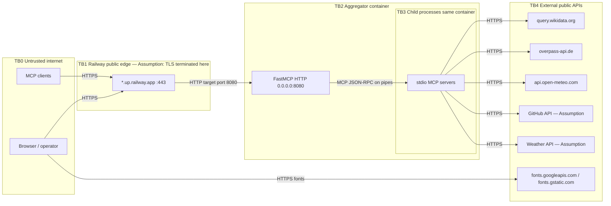
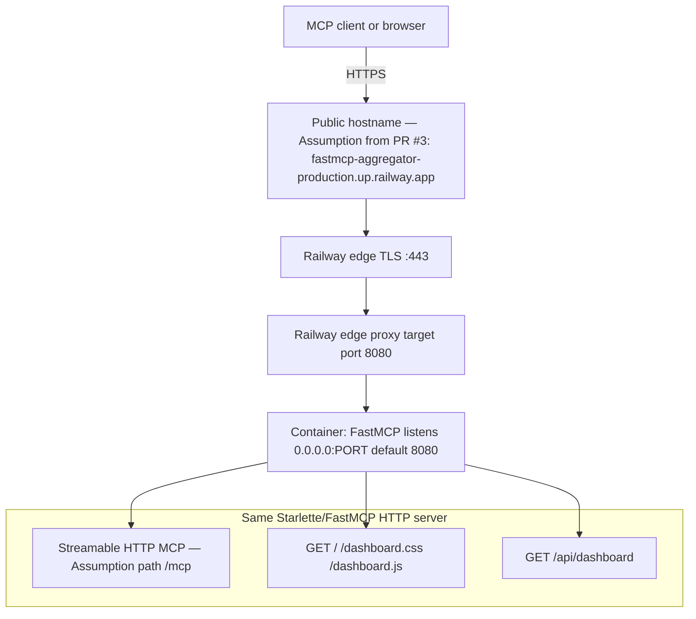
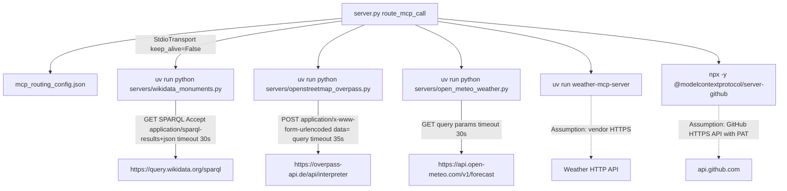
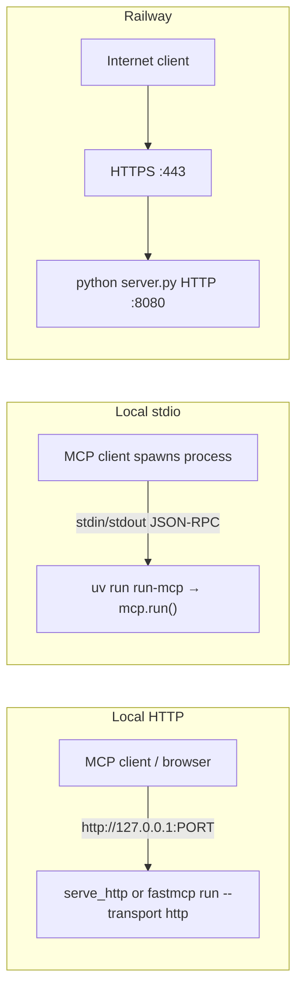

# Connectivity

Network and process connectivity for the universal MCP aggregator. Companion to [ARCHITECTURE.md](ARCHITECTURE.md).

Every inbound/outbound edge below is taken from this repository’s code and config, from FastMCP 4’s documented HTTP defaults where this repo does not override them, or from [PR #3](https://github.com/mkrejp/FastMCP-testserver/pull/3) for Railway. Unverified items are marked **Assumption**.

## Trust boundaries

| Boundary | What it separates | Auth at the boundary |
| --- | --- | --- |
| TB0 → TB1 | Public clients and Railway’s HTTPS domain | **None in this app.** Railway may still require a valid TLS client handshake to the edge certificate. **Assumption:** no Railway edge auth / IP allowlist is configured in-repo (none is committed). |
| TB1 → TB2 | Edge proxy and the container listener | None. Proxy forwards to `0.0.0.0:$PORT`. |
| TB2 → TB3 | Aggregator Python process and child MCP processes | None. Children inherit a copied `os.environ` plus resolved routing `env`. |
| TB3 → TB4 | Child processes and third-party HTTPS APIs | None for in-tree bridges. Example servers pass `WEATHER_API_KEY` / `GITHUB_PERSONAL_ACCESS_TOKEN` into the child environment. |
| Browser → Google Fonts | Operator’s browser, not the container | None (public CDN). |

Local stdio mode (`uv run run-mcp`) skips TB1: the MCP client spawns the aggregator as a subprocess and speaks MCP on stdin/stdout (TB0/client machine ↔ TB2 on the same host).

## End-to-end inbound path (Railway HTTP)

What [PR #3](https://github.com/mkrejp/FastMCP-testserver/pull/3) established:

- Railpack starts `python server.py`.
- `__main__` must call `serve_http()`, not `mcp.run()` (stdio).
- Bind host `0.0.0.0`, port from `PORT` (production `8080`).
- Public domain target port is 8080. A stdio-only process produced HTTP 502 “Application failed to respond”.

This application does **not** enable FastMCP’s legacy SSE transport (`transport="sse"`). Dashboard updates are periodic `fetch`, not EventSource.

## Process and outbound path

In-tree bridges set `User-Agent: FastMCP-Testserver/0.1 (...)`. They use `httpx.AsyncClient` and `response.raise_for_status()`.

`weather-service` and `github-service` are **not implemented in this repo**. Their outbound hosts, paths, and ports are therefore assumptions.

## Local vs Railway transports

| Mode | How it starts | Listen | MCP transport |
| --- | --- | --- | --- |
| Railway / `python server.py` | `__main__` → `serve_http()` | `0.0.0.0` + `PORT` (default 8080) | Streamable HTTP |
| README Codespaces example | `uv run fastmcp run server.py --transport http --host 0.0.0.0 --port 8000` | `0.0.0.0:8000` | Streamable HTTP |
| Local CLI | `uv run run-mcp` | none | stdio |
| Downstream bridges | `mcp.run()` in each `servers/*.py` | none | stdio (parent is the aggregator) |

## Connection inventory

Direction is from the **initiator**. Ports are destination ports. “Auth” is what this codebase implements or passes through; platform TLS is listed separately.

| # | Source | Destination | Protocol | Port | Auth | Direction | Evidence |
| --- | --- | --- | --- | --- | --- | --- | --- |
| 1 | MCP client | Railway public hostname | HTTPS (TLS) carrying Streamable HTTP / MCP | 443 | None in app. **Assumption:** edge presents Railway-managed cert. | Client → edge | PR #3 URL; FastMCP HTTP; README `/mcp` |
| 2 | Railway edge | Aggregator process | HTTP (cleartext inside the mesh) | `PORT` (8080 in production / default) | None | Edge → app | `serve_http()`; PR #3 target port 8080 |
| 3 | MCP client (local HTTP) | Aggregator | HTTP Streamable MCP | 8080 default, or 8000 if using the README CLI | None | Client → app | `http_port()`, README |
| 4 | MCP client (local stdio) | Aggregator process | MCP over stdio (OS pipes) | n/a | None | Client ↔ app | `run-mcp = "server:mcp.run"` |
| 5 | Browser | Aggregator `GET /`, `/dashboard.css`, `/dashboard.js` | HTTP(S) same as #1/#2 or #3 | 443 or listen port | None | Browser → app | `custom_route` handlers |
| 6 | Browser | Aggregator `GET /api/dashboard` | HTTP(S) JSON | 443 or listen port | None | Browser → app | `dashboard.js` `fetch`; 5s interval |
| 7 | Browser | `fonts.googleapis.com`, `fonts.gstatic.com` | HTTPS | 443 | None | Browser → CDN | `dashboard/index.html` `<link>` |
| 8 | Aggregator | Child MCP (`command` + `args`) | MCP over stdio | n/a | Child env may contain secrets from host env | Aggregator → child (request/response on pipes) | `StdioTransport(..., keep_alive=False)` |
| 9 | `wikidata-monuments` child | `https://query.wikidata.org/sparql` | HTTPS GET, query string `query=` | 443 | None (public SPARQL). User-Agent header only. | Child → Wikidata | `SPARQL_ENDPOINT`, `HEADERS` |
| 10 | `openstreetmap-overpass` child | `https://overpass-api.de/api/interpreter` | HTTPS POST form field `data` | 443 | None. User-Agent header only. | Child → Overpass | `OVERPASS_ENDPOINT` |
| 11 | `open-meteo-weather` child | `https://api.open-meteo.com/v1/forecast` | HTTPS GET | 443 | None. User-Agent header only. | Child → Open-Meteo | `FORECAST_ENDPOINT` |
| 12 | `weather-service` child | **Assumption:** vendor weather HTTPS API | HTTPS | 443 **Assumption** | `WEATHER_API_KEY` in child env | Child → API | routing `env` only; package not in-repo |
| 13 | `github-service` child | **Assumption:** GitHub REST/GraphQL HTTPS | HTTPS | 443 **Assumption** | `GITHUB_PERSONAL_ACCESS_TOKEN` in child env | Child → GitHub | routing `env` + npx package name |
| 14 | Operator / CI machine | `pypi.org` (uv sync / Railpack install) | HTTPS | 443 | None (public index) | Build → PyPI | `uv.lock`, Railpack Python+uv **Assumption** for Railway builds |
| 15 | `github-service` start | npm registry via `npx -y` | HTTPS | 443 **Assumption** | None unless npm token is in the environment | Child start → npm | config `npx` args; not otherwise configured here |

No TCP listen besides the FastMCP HTTP server is opened by this repository. Downstream servers do not bind ports. There is no Railway private-domain (`*.railway.internal`) usage in code. There is no database, Redis, or object-storage connection.

## Auth points (explicit non-auth)

| Surface | Mechanism in this repo |
| --- | --- |
| `/mcp` Streamable HTTP | None (`FastMCP("universal-mcp-server")` has no `auth=`) |
| Dashboard HTML/CSS/JS and `/api/dashboard` | None |
| Stdio aggregator | Whoever can spawn `run-mcp` on the host |
| Routing-config commands | Host OS permissions; config is trusted |
| Wikidata / Overpass / Open-Meteo | Unauthenticated HTTPS |
| Example weather / GitHub children | Host env vars interpolated into child `env` |
| `.env.example` `API_SECRET_KEY` | **Unused** — not an auth point |

`display_args()` and dashboard `env` listing are display redaction only; they do not authenticate callers.

## Protocols and transports (summary)

| Name | Where used | Notes |
| --- | --- | --- |
| Streamable HTTP | Aggregator public/local HTTP MCP | FastMCP `transport="http"`. Path **Assumption** `/mcp`. |
| SSE (legacy MCP) | **Not used** | Do not configure clients for `transport="sse"` against this server. |
| HTTP/1 JSON | Dashboard REST | `GET /api/dashboard` |
| MCP stdio | Aggregator↔children; `run-mcp`; each `servers/*.py` `mcp.run()` | JSON-RPC on stdin/stdout |
| HTTPS | All third-party APIs; Railway public access | Bridges call `https://…` URLs. App does not terminate TLS. |

## Assumptions (index)

1. MCP HTTP URL path is `/mcp` (README + FastMCP 4 default).
2. Railway edge: TLS on 443, HTTP to container 8080, hostname from PR #3, automatic deploys from `main`.
3. Intra-Railway hop from edge to container is HTTP (standard Railway public-domain behavior).
4. `weather-service` / `github-service` destinations, ports, and TLS details belong to those packages.
5. `npx` may contact the public npm registry on first launch (`-y`).
6. Google Fonts are fetched by the **browser**, not by the aggregator process.
7. No additional Railway TCP proxies, custom domains, or private networking are defined in this repository.
